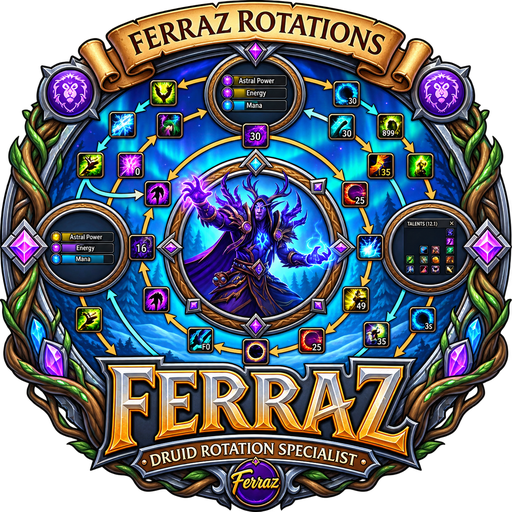

<!-- Generated by site/build.py from site/guides.md and CHANGELOG.md. Do not edit by hand. -->

<h1 align="center">Ferraz Rotations</h1>

Druid and Demon Hunter rotations for Simia Pro · Patch 12.1 
<a href="https://toferraz-dev.github.io/Ferraz-Rotations/"><b>Open the website</b></a> · <a href="https://toferraz-dev.github.io/Ferraz-Rotations/rotations/Ferraz-Rotations.zip">Download all rotations (.zip)</a> · <a href="CHANGELOG.md">Changelog</a>

Restoration, Guardian, Balance and Feral Druid, each tuned separately for Mythic+ and Raid, plus Devourer Demon Hunter for Mythic+. The website has a full guide for every rotation: what it does on its own, what stays with you, every setting with its default, and what changed recently.

| Rotation | Role | Version | Updated | Download |
|---|---|---|---|---|
| [Restoration · Mythic+](https://toferraz-dev.github.io/Ferraz-Rotations/#resto-mplus) | Healer | 34.0.0 | 2026-10-23 | [FerrazRestoDruid.yaml](https://toferraz-dev.github.io/Ferraz-Rotations/rotations/FerrazRestoDruid.yaml) |
| [Restoration · Raid](https://toferraz-dev.github.io/Ferraz-Rotations/#resto-raid) | Healer | 26.0.0 | 2026-10-23 | [FerrazRestoDruidRaid.yaml](https://toferraz-dev.github.io/Ferraz-Rotations/rotations/FerrazRestoDruidRaid.yaml) |
| [Guardian · Mythic+](https://toferraz-dev.github.io/Ferraz-Rotations/#guardian) | Tank | 4.0.0 | 2026-10-23 | [FerrazGuardianElune.yaml](https://toferraz-dev.github.io/Ferraz-Rotations/rotations/FerrazGuardianElune.yaml) |
| [Balance · Mythic+](https://toferraz-dev.github.io/Ferraz-Rotations/#balance-mplus) | DPS | 13.0.0 | 2026-10-23 | [FerrazBalance.yaml](https://toferraz-dev.github.io/Ferraz-Rotations/rotations/FerrazBalance.yaml) |
| [Balance · Raid](https://toferraz-dev.github.io/Ferraz-Rotations/#balance-raid) | DPS | 9.0.0 | 2026-10-23 | [FerrazBalanceRaid.yaml](https://toferraz-dev.github.io/Ferraz-Rotations/rotations/FerrazBalanceRaid.yaml) |
| [Feral · Mythic+](https://toferraz-dev.github.io/Ferraz-Rotations/#feral-mplus) | DPS | 9.0.0 | 2026-10-23 | [FerrazFeral.yaml](https://toferraz-dev.github.io/Ferraz-Rotations/rotations/FerrazFeral.yaml) |
| [Feral · Raid](https://toferraz-dev.github.io/Ferraz-Rotations/#feral-raid) | DPS | 6.0.0 | 2026-10-23 | [FerrazFeralRaid.yaml](https://toferraz-dev.github.io/Ferraz-Rotations/rotations/FerrazFeralRaid.yaml) |
| [Devourer · Mythic+](https://toferraz-dev.github.io/Ferraz-Rotations/#devourer-mplus) | DPS | 1.0.0 | 2026-10-23 | [FerrazDevourer.yaml](https://toferraz-dev.github.io/Ferraz-Rotations/rotations/FerrazDevourer.yaml) |
